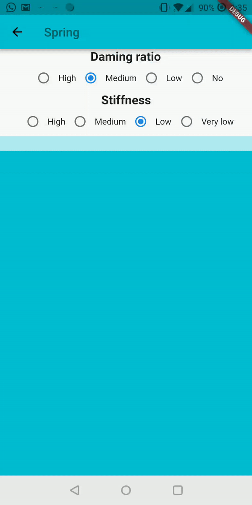
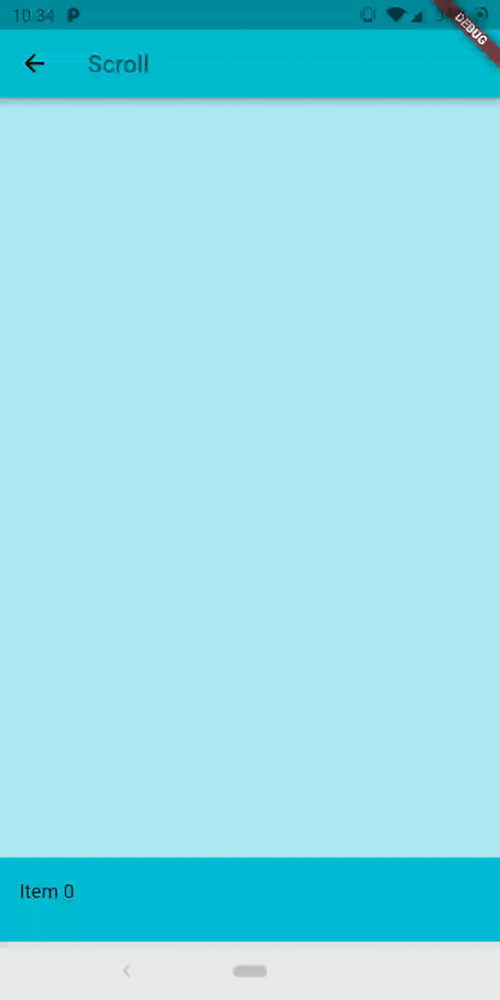

<a href="https://github.com/Solido/awesome-flutter">
   
</a>

*An elastic material bottom sheet implementation for Flutter.*

Requires Flutter 3.44 or later and Dart 3.12 or later.

This is still an early preview, some behaviors can change or being removed. Every feedback, bug report or feature request is welcome, please send it at the [issue tracker](https://github.com/mcrovero/rubber/issues)

Follow the [Quick Start](https://github.com/mcrovero/rubber/wiki/Quick-start) to add it to your project.
Is also available the complete [example](https://github.com/mcrovero/rubber/tree/master/example) in the repository to preview the library on your device.

Common interaction options can be configured directly on the sheet:

```dart
RubberBottomSheet(
  animationController: controller,
  lowerLayer: const MyBackground(),
  upperLayer: const MySheetContent(),
  draggable: true,
  snapThreshold: 0.4,
  minFlingVelocity: 700,
  completeFlingVelocity: 5000,
  scrimColor: Colors.black54,
  onScrimTap: controller.collapse,
);
```

Use strict bounds when the elastic overscroll effect is not appropriate:

```dart
final controller = RubberAnimationController(
  vsync: this,
  duration: const Duration(milliseconds: 250),
  boundsBehavior: RubberAnimationBoundsBehavior.strict,
);
```

Use `controller.addListener(...)` to observe the position continuously. Status
listeners report direction and boundary transitions (`forward`, `reverse`,
`completed`, and `dismissed`). Pixel bounds are automatically recalculated
after size and orientation changes.

<table>
  <tr>
    <td></td>
    <td></td>
  </tr>
</table>
